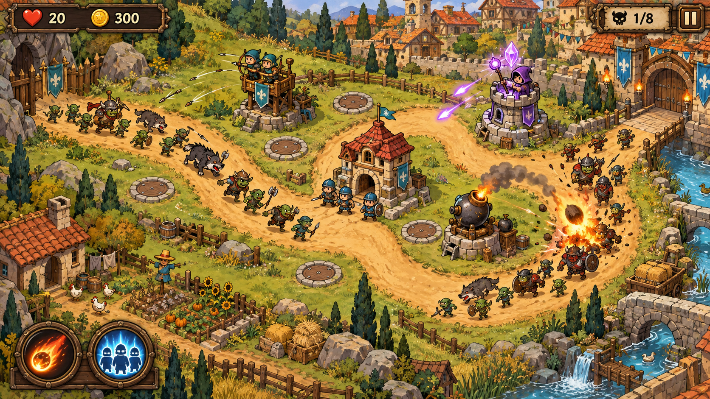

# 暮境守卫 · Duskward Defense

一款使用 **Godot 4.7.2 标准版 / GDScript** 制作的 Windows 离线单机塔防游戏。当前版本 **0.4.1-dev**，包含六关战役和手绘卡通战场。

当前仓库保存完整工程源码、美术、音乐、音效和开发文档。**尚未提供可独立运行的 Windows EXE 发行包。**

这张图是画风参考，实际战场采用独立地形、建筑、角色动作和可交互界面。

## 已有玩法

- 村庄、森林、峡谷、沼泽、雪地和火山六张不同地图，共58波。
- 弓箭塔、兵营、法师塔、炮塔；每类四级，四级有两个分支，共20种建筑结构图片。
- 九类敌人，包含快速、护甲、魔抗和飞行单位。
- 兵营士兵可调整集结点，实际移动、拦截、攻击并补员。
- 陨火与援军两个主动技能；直接点击战场塔位建造和升级。
- 六套连续行走/振翅及攻击动作，共72帧。
- 三段原创循环背景音乐、14类音效，音乐与音效独立开关和音量。
- 教学、暂停、1倍/2倍速度、重试、结算、下一关和本地进度存档。
- 默认全屏，F11切换窗口，支持最大化和窗口铺满；菜单背景完整显示。

## 运行工程

1. 从 [Godot 官方下载页](https://godotengine.org/download/windows/) 下载 **Godot 4.7.2 标准版 Windows x64**，本项目不需要.NET版。
2. 克隆或下载本仓库，解压到可写目录。
3. 在Godot项目管理器中导入根目录 `project.godot`，等待素材导入完成。
4. 打开工程，按 **F5** 运行游戏。

本机开发环境还支持双击 `开始游戏.cmd`：需将便携Godot放入 `tools/godot/`，对应可执行文件名为 `Godot_v4.7.2-stable_win64.exe`。引擎和下载压缩包不纳入仓库；从GitHub下载源码后可直接采用上面的Godot导入方式。

游戏运行无需Python、插件、账号或联网。重新合成音频时才需要Python标准库，详见 [音频说明](audio/README.md)。

## 操作

| 操作 | 方式 |
| --- | --- |
| 建塔或升级 | 点击地图中的塔位或建筑，再点击附近图标 |
| 调整兵营集结点 | 点击兵营旗帜，再点击范围内道路 |
| 陨火 / 援军 | 左下角技能图标或数字1 / 2，再选择目标 |
| 开始下一波 | 入口骷髅旗或空格 |
| 暂停 / 继续 | Esc或顶部暂停按钮 |
| 取消选择 | 鼠标右键 |
| 全屏 / 窗口 | F11或主菜单设置 |

## 开发文档

接续开发前，先读 [当前进度](当前进度.md)，再核对 [产品需求](产品需求.md) 和 [软件架构](软件架构.md)。三份文档记录已确认事项、实际完成内容、验证范围和后续限制。

游戏此前暂用名“守望边境”。为保留旧进度，Windows存档继续使用原目录 `%APPDATA%/Godot/app_userdata/守望边境 · 开发版/`，存档格式仍为 `schema_version=1`。

## 验证

素材导入完成后，在PowerShell运行 `./测试游戏.ps1`，需本机 `tools/godot/Godot_v4.7.2-stable_win64_console.exe`。

- 十个无界面脚本覆盖战斗、存档、界面、集结、动画、经济通关、六关战役、素材和音频。
- `tests/capture_display.gd` 用真实图形设备检查窗口尺寸、鼠标点选、最大化、全屏和菜单截图；不能用无图形模式替代。
- 既有0.4.0-dev基线为231项无界面＋19项图形检查；后续版本的实际复验结果见当前进度文档，不混用历史结果。
- 测试输出位于 `tests/output/`，测试存档与玩家存档分离。

## 当前限制

这是可玩的开发版。独立Windows发行包、专用死亡动作、多方向动作和进一步音色/难度打磨尚未完成；英雄系统暂缓。当前采用完整画布按宽高铺满，超宽屏可能拉伸。自动通关不等于主观难度已最终验收。

## 资源来源

来源登记见 [licenses/sources.json](licenses/sources.json)。手绘图片使用会话内置图像工具制作；声音为本项目代码原创合成，无外部商业录音或付费运行服务。字体调用Windows现有系统字体，不打包字体文件。

Godot引擎和相关第三方声明须在后续独立发行时按其要求附带。当前尚未选择项目的开源许可证；仓库首次上传按私有版本备份处理。
